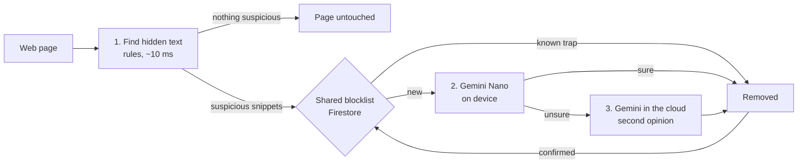

<div align="center">


# Untrap

**Safe Browsing for AI agents.**

A Chrome extension that finds prompt-injection traps hidden in web pages and removes them before any AI reads the page. Gemini Nano checks every page on your device, cloud Gemini gives a second opinion only when needed, and confirmed traps go into a shared blocklist that protects everyone.

Built with **Firebase AI Logic hybrid inference** (Gemini Nano on-device + Gemini in the cloud), App Check and Cloud Firestore.

</div>

---

## The problem

AI agents now browse for people: they summarize pages, fill in forms, shop and run code. Attackers have noticed. They hide instructions in parts of a page that people never see but AI agents read:

- HTML comments, `display:none` blocks, 1px or transparent text, white-on-white text
- text pushed off-screen, image alt text, meta tags, invisible Unicode characters

Researchers found these live on real sites in 2026: a hidden note asking agents with payment access to **send $5,000 through PayPal**, a hidden **`sudo rm -rf`** aimed at coding agents, and hidden requests to **leak API keys** ([Forcepoint X-Labs](https://www.forcepoint.com/blog/x-labs/indirect-prompt-injection-payloads)). Google measured a **32% rise** in pages carrying hidden AI attacks between November 2025 and February 2026 ([Cloud Security Alliance](https://labs.cloudsecurityalliance.org/research/csa-research-note-indirect-prompt-injection-in-the-wild-2026/)).

Chrome protects its own Gemini agent. Every other AI that reads pages in Chrome (Claude, ChatGPT and Perplexity extensions, AI sidebars, people's own agents) is on its own. Untrap cleans the page for all of them.

## How it works



1. **Find.** A content script walks the page and finds text people can't see, using real computed styles and layout. A fast rule pass scores how much each piece looks like an order for an AI. Most pages have nothing worth checking and finish in milliseconds.
2. **Remove the obvious right away.** Hidden text with strong signals is removed before any model runs. People can't see hidden text, so removing it changes nothing for them.
3. **Ask Gemini Nano.** Every suspicious snippet is judged with **Firebase AI Logic in `PREFER_ON_DEVICE` mode**: Gemini Nano inside Chrome when it's ready (private, free, offline), and Gemini in the cloud when it isn't. The verdict comes back as structured JSON (verdict, category, confidence, reason).
4. **Second opinion.** When Nano is unsure, or disagrees strongly with the rules, the snippet (never the page) goes to a larger cloud model with `ONLY_IN_CLOUD`.
5. **Protect everyone.** Confirmed traps are added to a shared blocklist in Cloud Firestore, keyed by a SHA-256 fingerprint of the text. The next person who meets the same trap is protected without running any model.

Visible text is only removed when the model is sure. Unsure visible text is outlined, not removed. Pausing Untrap on a site puts every change back.

### Why hybrid

| | On-device (Gemini Nano) | Cloud (Gemini) |
|---|---|---|
| Runs on | Every suspicious snippet | Only unsure snippets, or computers without Nano |
| Sees | Text from the pages you browse | One snippet at a time, never the page or URL |
| Cost | Free | Pay per call |
| Works offline | Yes | No |

Scanning every page in the cloud would send people's browsing to a server and cost money per page. Nano makes it private and free; the cloud catches what Nano can't.

## Features

- **Badge** on every page: green when clean, red with the number of traps removed.
- **X-ray mode**: outlines and pins every trap on the page, with the hidden text, how it was hidden, what it tried to make the AI do, and which layer caught it.
- **Attack Lab**: a normal-looking review blog with 11 traps modelled on real ones, plus harmless hidden things that must be left alone.
- **Settings**: turn off cloud second opinions or the shared blocklist, pause sites.
- **Rules-only fallback**: with no model available at all, Untrap still removes hidden text with strong signals.

## Try it

1. Download `untrap-extension.zip` from the [latest release](https://github.com/Priyansh10ff/Untrap/releases) and unzip it.
2. Open `chrome://extensions`, turn on **Developer mode**, click **Load unpacked** and pick the folder.
3. On the welcome page, click **Download Gemini Nano** (needs desktop Chrome 138+, 22 GB free disk space, and a GPU with 4 GB+ VRAM or 16 GB RAM).
4. Open the **Attack Lab**, click the Untrap icon and press **X-ray this page**.

## Build it yourself

```bash
npm install
cp .env.example .env      # then fill it in (see below)
npm run check             # typecheck + tests + build
```

Load `dist/extension` with **Load unpacked**. `npm run watch` rebuilds on every change.

### Firebase setup

1. Create a Firebase project and add a **Web app**. Copy its config into `.env`.
2. **AI Logic**: open *AI Logic* in the console and enable the **Gemini Developer API**.
3. **Firestore**: create a database, then deploy the rules: `npx firebase-tools deploy --only firestore:rules`.
4. **App Check**: register the web app with **reCAPTCHA Enterprise** (for the website) and put the site key in `.env`. Chrome extensions can't run reCAPTCHA, so add a **debug token** under *Manage debug tokens* and put it in `APPCHECK_DEBUG_TOKEN`. Then enforce App Check for AI Logic and Firestore.
5. **Website**: `npm run build && npx firebase-tools deploy --only hosting` publishes the landing page and the Attack Lab.

`.env` is git-ignored. Never commit it: the debug token lets anyone use your AI quota.

## Privacy

- **Stays on your computer:** the pages you visit, their text, and the first AI check.
- **Sent only when needed:** a single suspicious snippet, for a cloud second opinion. Can be turned off.
- **Shared:** for confirmed traps only, the text fingerprint, the trap type, a one-line reason and the attacking site's hostname. Never your browsing history. Can be turned off.

## Project structure

```
src/core/        page extraction, rules, prompt + JSON schema, decision policy (no Chrome APIs)
src/extension/   content script, background worker, offscreen AI engine, popup, settings, X-ray
src/site/        landing page and Attack Lab (Firebase Hosting)
test/            unit tests (Vitest) and the Attack Lab trap list
scripts/         build, browser test, zip
firestore.rules  shared blocklist and counters
```

## Tests

```bash
npm test                 # rules, prompt, policy
npm run test:browser     # runs the real extractor in Chromium on the Attack Lab (needs Playwright)
```

The browser test checks that all 11 Attack Lab traps are found with the right technique, at desktop and phone widths, and that the harmless hidden text (skip links, screen-reader ratings, hidden menus, build comments) is left alone.

## Limits

- Gemini Nano needs desktop Chrome with enough disk space and memory. Without it, Untrap uses cloud Gemini (if allowed) or rules only.
- Untrap reads the DOM. Agents that only look at screenshots aren't exposed to hidden text, and text drawn inside images isn't checked.
- Cross-origin iframes aren't scanned yet.
- A determined attacker can write instructions that read like normal content. Untrap raises the bar; it isn't a guarantee.

## License

[Apache 2.0](LICENSE)
